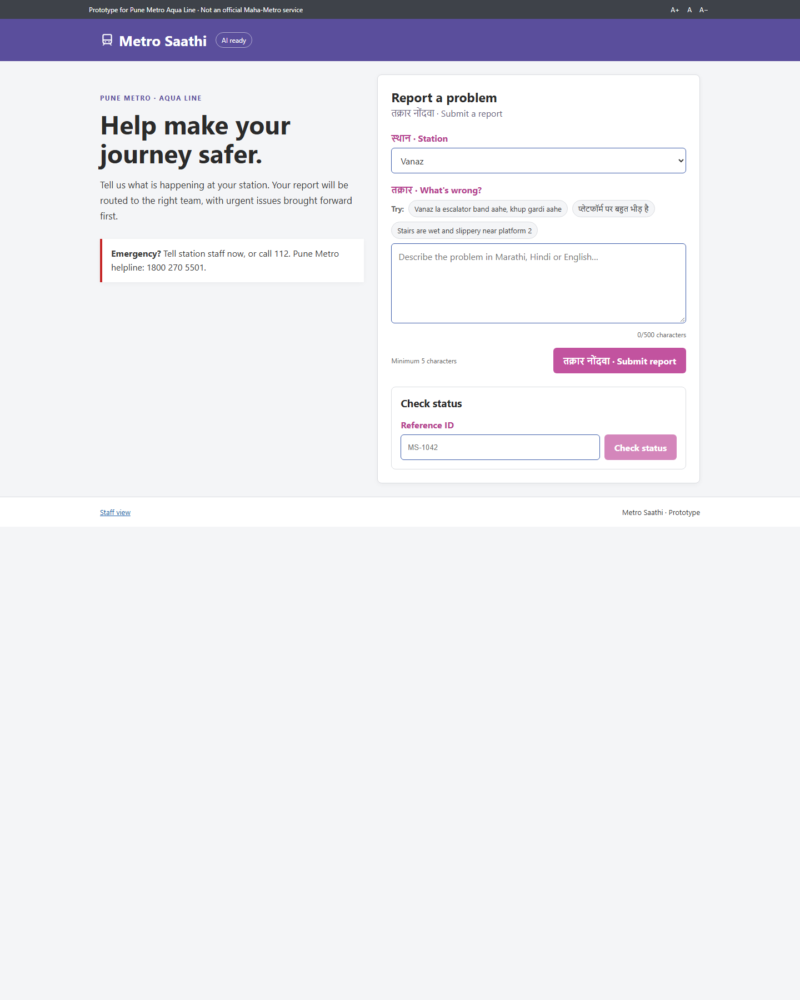
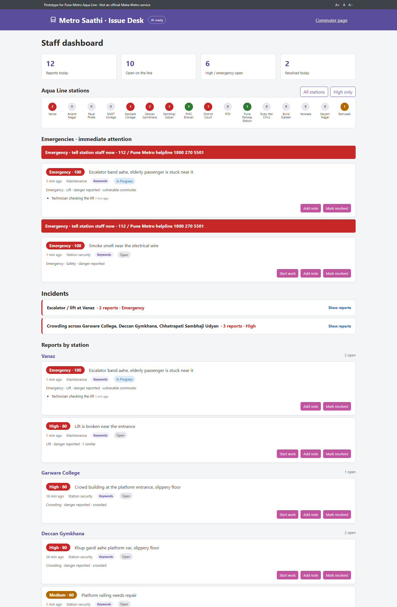
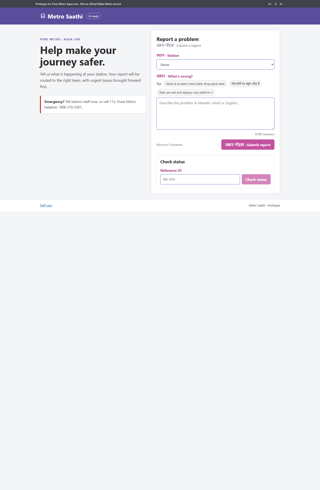

# Metro Saathi

**AI understands the complaint; clear rules set its priority.** Report a Pune Metro issue in Marathi, Hindi, or English and route it to the right team.

## Try the prototype

| Page | Link |
| --- | --- |
| Commuter report | [metro-saathi.onrender.com](https://metro-saathi.onrender.com) |
| Staff issue desk | [metro-saathi.onrender.com/staff](https://metro-saathi.onrender.com/staff) |

The first page load may take about 50 seconds while the hosted service wakes up.

## The problem and who it serves

Commuters may notice broken lifts, unsafe floors, crowding, or ticketing problems but lack a quick way to report them in the language they use. Metro Saathi is a lightweight reporting prototype for commuters and the station teams who need to triage and resolve those issues.

## Screenshots







## How it works

1. A commuter submits a report in Marathi, Hindi, or English.
2. OpenAI extracts the category and safety signals; keyword rules provide a fallback when the key is missing or the call fails.
3. A rule-based formula calculates priority. AI never chooses the score.
4. Staff review reports grouped by station, handle urgent issues, and update statuses.
5. Similar reports at nearby stations are grouped into incidents.
6. Commuters check progress with the report reference ID.

**AI understands, rules decide.**

### Priority formula

`priority = base[category] + danger + vulnerable + crowded + similar reports`

| Category | Base score |
| --- | ---: |
| Safety | 60 |
| Escalator or lift | 50 |
| Crowding | 45 |
| Ticketing | 30 |
| Cleanliness | 25 |
| Other | 20 |

| Signal | Score added |
| --- | ---: |
| Danger reported | +25 |
| Vulnerable commuter | +10 |
| Crowded area | +10 |
| Similar reports today at the same station and category | +5 each, up to +15 |

Non-emergency scores cap at 99. An emergency report is 100.

| Score | Label |
| ---: | --- |
| Emergency report | Emergency (100) |
| 70–99 | High |
| 40–69 | Medium |
| 0–39 | Low |

### Incident grouping rule

Open reports of the same category are connected when they are at the same or an adjacent Aqua Line station and within 60 minutes. Grouping follows those links transitively, so a chain can span more than 60 minutes end to end. Resolved reports are excluded.

## Features

- Bilingual commuter form with examples in Romanized Marathi, Devanagari Hindi, and English.
- OpenAI classification with a keyword fallback for English, Marathi, and Hindi terms.
- Rule-based urgency scores and team routing.
- Staff dashboard grouped by station, with a High only filter, emergency banner, and live refresh.
- Incident grouping with expandable linked reports.
- Report lifecycle: open, in progress, resolved, and reopen, with staff notes.
- Status lookup by reference ID, including the latest staff note.
- Responsive layout for laptop and phone screens.

## Tech stack

| Layer | Technology |
| --- | --- |
| Frontend | React, Vite, plain CSS |
| Backend | Node.js, Express, ES modules |
| AI understanding | OpenAI Responses API, `gpt-4o-mini` |
| Priority and fallback | Plain JavaScript rules and keyword matching |
| Storage | In-memory array; resets when the server restarts |

## Tests

Run the built-in Node.js tests:

```sh
npm test
```

## Run locally

Requires Node.js 20 or newer.

1. Install dependencies:

   ```sh
   npm install
   ```

2. Add your key to `server/.env` (keep this file private):

   ```env
   OPENAI_API_KEY=your_api_key_here
   ```

   Without a key, keyword fallback remains available.

3. Start the API server in one terminal:

   ```sh
   npm start
   ```

4. Start the Vite frontend in another terminal:

   ```sh
   npm run dev
   ```

   Open the local URL printed by Vite, usually `http://localhost:5173`.

## About this prototype

Built with OpenAI Codex at DevDay Exchange Community Metro Hackathon, Pune (Oct 2026).

This is a prototype, not an official Maha-Metro service. It does not ask for an account or identity details. Reports use in-memory sample data that resets when the server restarts. The app flags and routes reports; it does not contact emergency services or dispatch staff.

## Next steps

- Add API rate limiting.
- Tune priority weights with real, reviewed complaint data.
- Support photo evidence.
- Add staff login and access controls.
